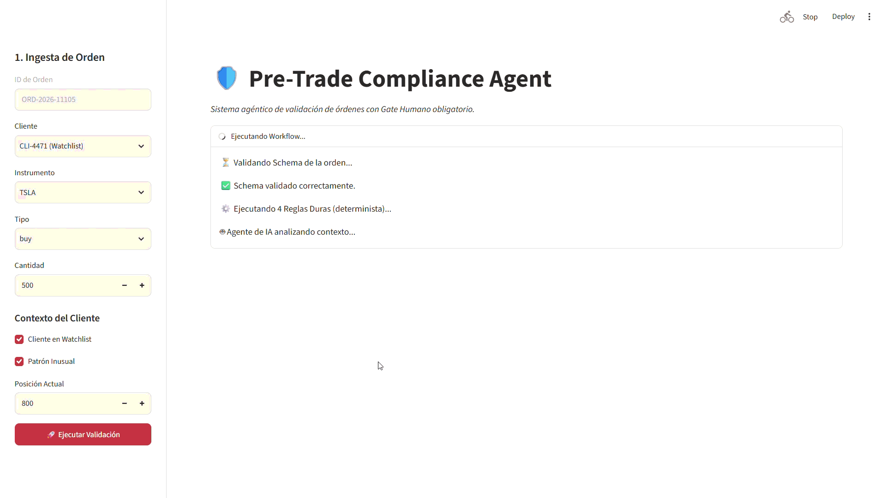
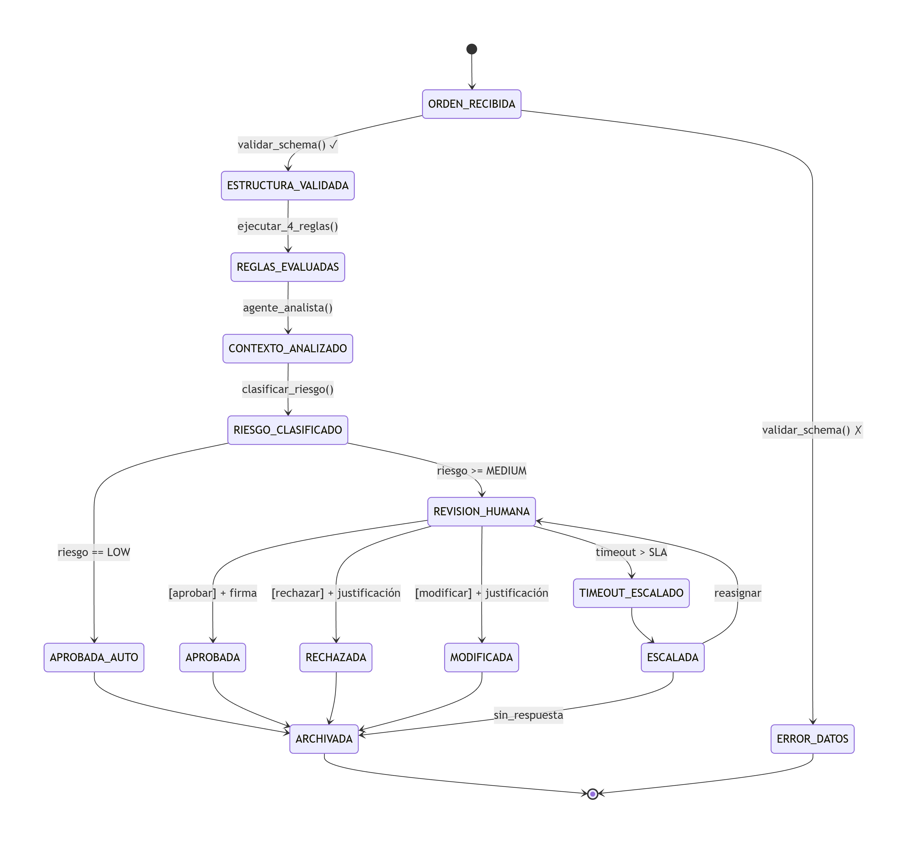

# Pre-Trade Compliance Agent

> Sistema agéntico para la validación de órdenes financieras (stocks, forex, crypto, futures, opciones) contra reglas duras deterministas, análisis de contexto por agentes y gate humano obligatorio. **Este sistema NO ejecuta órdenes, solo las audita y recomienda.**

<!-- Aquí irá tu GIF de 30 segundos. Por ahora déjalo así: -->


## 🎯 El Problema
En las mesas institucionales y brokers, un *Compliance Officer* revisa manualmente cientos de órdenes al día. Debe cruzar límites de posición, listas de restricción, concentración sectorial y patrones de *wash trading*. Este proceso manual es lento (3-5 min por orden), propenso a errores por fatiga y difícil de auditar de forma consistente. Además, el contexto del cliente (ej. si está en una watchlist o tiene un patrón inusual) a menudo se pasa por alto.

## 💡 La Solución
Un workflow determinista que pre-filtra las órdenes usando **reglas duras (scripts)**. Las órdenes que superan el filtro pasan por un **agente de IA** que analiza el contexto no estructurado y clasifica el riesgo. Finalmente, un **humano (gate obligatorio)** aprueba o rechaza. El sistema garantiza que ninguna orden se ejecute sin trazabilidad completa y que la IA nunca pueda anular una regla dura.

## 🏗️ Arquitectura de Software
El sistema está diseñado bajo un patrón de **Orquestación de Workflow Determinista (Deterministic Workflow Orchestration)**. Esta arquitectura implementa un motor de estados con **guardas condicionales**, **persistencia de artefactos en formato JSON** y **transiciones auditables**. 

La arquitectura separa estrictamente el **motor de control** (que dicta el flujo) de la **lógica de negocio** (reglas y agentes), garantizando que la IA nunca asuma la autonomía del flujo de ejecución.



**Los 8 estados del esqueleto v0:**
1. `ORDEN_RECIBIDA`: Ingesta del JSON.
2. `ESTRUCTURA_VALIDADA`: Validación de schema.
3. `REGLAS_EVALUADAS`: Ejecución de reglas duras (determinista).
4. `CONTEXTO_ANALIZADO`: El agente analiza patrones no capturados por reglas.
5. `RIESGO_CLASIFICADO`: Asignación de nivel (LOW, MEDIUM, HIGH, CRITICAL).
6. `REVISION_HUMANA`: Gate obligatorio para riesgo >= MEDIUM.
7. `APROBADA / RECHAZADA`: Decisión final del oficial.
8. `ARCHIVADA`: Auditoría idempotente.

**Componentes de la Arquitectura:**
*   **Workflow Engine (Orquestador):** El motor que dicta las transiciones. Es puramente determinista y no usa IA.
*   **Motor de Reglas (Scripts):** Validaciones duras e inmutables (R1 a R4).
*   **Agente de Contexto (IA):** Función acotada que analiza datos no estructurados.
*   **Guardas (Guardrails):** Controles de seguridad que validan las transiciones (ej. Piso de reglas duras).
*   **Gate Humano:** Interfaz de decisión final con firma digital.

### El Agente (LLM vía API)
El agente de análisis de contexto **no es un agente autónomo**. Es una **función determinista con un LLM detrás**. 
*   **Modelo:** Realiza una única llamada HTTP a la API de OpenAI (por defecto `gpt-4o-mini`).
*   **Contrato:** El prompt fuerza al modelo a devolver un JSON estricto (`response_format={"type": "json_object"}`), validado contra nuestro schema.
*   **Desacoplamiento:** El cliente del LLM está aislado. Si mañana migramos a Anthropic, a un modelo local (Llama 3) o a Azure OpenAI, el Statechart y las Guardas no necesitan cambiar una sola línea de código.

### Stack Técnico
| Capa | Tecnología | Por qué |
| :--- | :--- | :--- |
| **Orquestador** | Python 3.12 | Lenguaje estándar para sistemas agénticos y financieros. |
| **Frontend (Gate)** | Streamlit | Prototipado rápido de la interfaz del Compliance Officer. |
| **Validación de Datos** | Pydantic + JSON Schema | Garantiza que la IA y los scripts hablen el mismo idioma. |
| **LLM Client** | OpenAI Python SDK | Llamada HTTP pura, sin frameworks de agentes pesados (LangChain). |
| **Persistencia** | File System (JSON) | Auditoría simple, legible y versionable con Git. |

## 🛡️ Decisiones de Diseño Clave (ADRs)
La arquitectura está diseñada para contener el no determinismo de los LLMs. Las decisiones más importantes están documentadas en los ADRs:
*   [ADR-001: Orquestador determinista en vez de agente orquestador](docs/adr/001-orquestador-determinista.md)
*   [ADR-002: Script para clasificación base, agente solo para contexto](docs/adr/002-script-vs-agente.md)
*   [ADR-003: Piso de reglas duras (la IA no puede bajar el riesgo)](docs/adr/003-piso-reglas-duras.md)
*   [ADR-004: Gate humano obligatorio y conflicto de interés](docs/adr/004-gate-humano.md)
*   [ADR-005: Artefactos como contratos inmutables](docs/adr/005-artefactos-schema.md)
*   [ADR-006: Hash de inputs para evitar aprobaciones obsoletas](docs/adr/006-hash-inputs.md)
*   [ADR-007: Idempotencia en el archivado](docs/adr/007-golden-dataset.md)


---

## 📊 Evaluaciones (Evals)

Para garantizar la calidad del sistema, contamos con un *Golden Dataset* de 10 casos sintéticos que cubren casos límite (watchlists, instrumentos restringidos, múltiples fallos de reglas). El script de evaluación (`evals/run_evals.py`) mide el rendimiento del sistema:

| Métrica | Resultado | Descripción |
| :--- | :--- | :--- |
| **Accuracy** | **100%** | Clasificación correcta de riesgo y aplicación del piso. |
| **Falsos Positivos** | **0%** | Ninguna orden trivial fue escalada innecesariamente a revisión humana. |
| **Falsos Negativos** | **0%** | Ninguna orden de alto riesgo evitó el gate humano. |
| **Cumplimiento de Guardas** | **100%** | El agente de IA nunca pudo anular los fallos de reglas duras. |


## 🚀 Cómo correrlo
```bash
# 1. Clonar el repo e instalar dependencias
pip install -r requirements.txt

# 2. Configurar variables de entorno
cp .env.example .env
# Añade tu API KEY en el archivo .env

# 3. Correr la demo en Streamlit
streamlit run demo/streamlit_app.py

# 4. Correr evaluaciones
python evals/run_evals.py