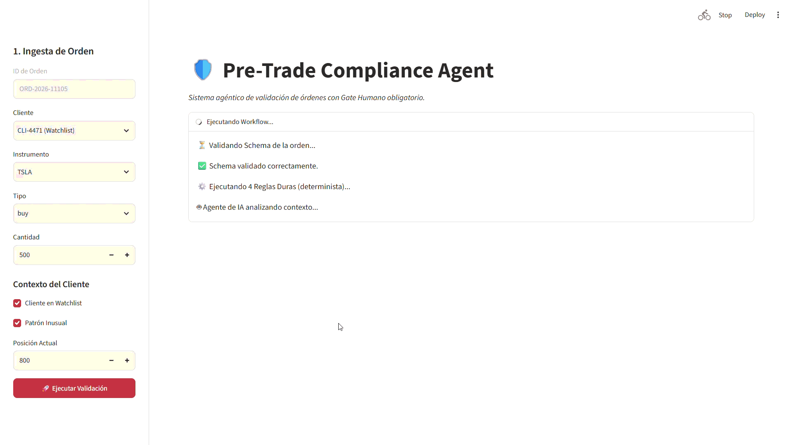
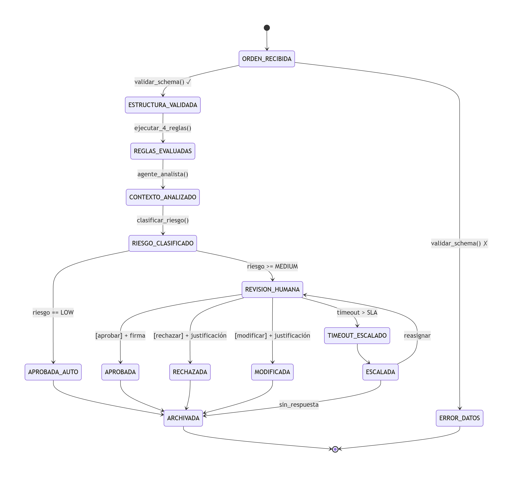

# Pre-Trade Compliance Agent


[Leer en Español](README.es.md)

> Agentic system for validating financial orders (stocks, forex, crypto, futures, options) against deterministic hard rules, context analysis by AI agents, and a mandatory human gate. **This system does NOT execute orders; it only audits and recommends.**



## 🎯 The Problem
In institutional trading desks and brokerages, a Compliance Officer manually reviews hundreds of orders daily. They must cross-reference position limits, restricted lists, sector concentration, and wash trading patterns. This manual process is slow (3-5 minutes per order), prone to fatigue-induced errors, and hard to audit consistently. Furthermore, client context (e.g., watchlist status or unusual patterns) is often overlooked.

## 💡 The Solution
A deterministic workflow that pre-filters orders using **hard rules (scripts)**. Orders that pass this filter go through an **AI agent** that analyzes unstructured context and classifies risk. Finally, a **human (mandatory gate)** approves or rejects. The system guarantees that no order is executed without full traceability and that the AI can never override a hard rule.

## 🏗️ Architecture & Flow
The system is based on a state machine (Statechart) ensuring every transition leaves an auditable artifact (JSON).



**The 8 states of the v0 skeleton:**
1. `ORDEN_RECIBIDA` (Order Received): JSON ingestion.
2. `ESTRUCTURA_VALIDADA` (Structure Validated): Schema validation.
3. `REGLAS_EVALUADAS` (Rules Evaluated): Hard rules execution (deterministic).
4. `CONTEXTO_ANALIZADO` (Context Analyzed): AI agent analyzes patterns missed by rules.
5. `RIESGO_CLASIFICADO` (Risk Classified): Level assignment (LOW, MEDIUM, HIGH, CRITICAL).
6. `REVISION_HUMANA` (Human Review): Mandatory gate for risk >= MEDIUM.
7. `APROBADA / RECHAZADA` (Approved / Rejected): Final decision by the officer.
8. `ARCHIVADA` (Archived): Idempotent auditing.

## 🛡️ Key Design Decisions (ADRs)
The architecture is designed to contain LLM non-determinism. The most important decisions are documented in ADRs:
*   [ADR-001: Deterministic orchestrator over agent orchestrator](docs/adr/001-orquestador-determinista.md)
*   [ADR-002: Script for base classification, agent only for context](docs/adr/002-script-vs-agente.md)
*   [ADR-003: Hard rule floor (AI cannot lower risk)](docs/adr/003-piso-reglas-duras.md)
*   [ADR-004: Mandatory human gate and conflict of interest](docs/adr/004-gate-humano.md)
*   [ADR-005: Artifacts as immutable contracts](docs/adr/005-artefactos-schema.md)
*   [ADR-006: Input hashing to prevent stale approvals](docs/adr/006-hash-inputs.md)
*   [ADR-007: Idempotency in archiving](docs/adr/007-golden-dataset.md)

## 📊 Evaluations (Evals)

To ensure system quality, we have a *Golden Dataset* of 10 synthetic cases covering edge cases (watchlists, restricted instruments, multiple rule failures). The evaluation script (`evals/run_evals.py`) measures the system's performance:

| Metric | Result | Description |
| :--- | :--- | :--- |
| **Accuracy** | **100%** | Correct risk classification and floor application. |
| **False Positives** | **0%** | No trivial orders were unnecessarily escalated to human review. |
| **False Negatives** | **0%** | No high-risk orders bypassed the human gate. |
| **Guardrail Compliance** | **100%** | The AI agent was never able to override hard rule failures. |


## 🚀 How to Run
```bash
# 1. Clone the repo and install dependencies
pip install -r requirements.txt

# 2. Set up environment variables
cp .env.example .env
# Add your API KEY to the .env file

# 3. Run the Streamlit demo
streamlit run demo/streamlit_app.py

python evals/run_evals.py